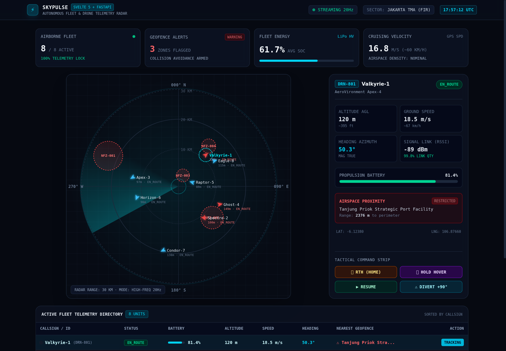
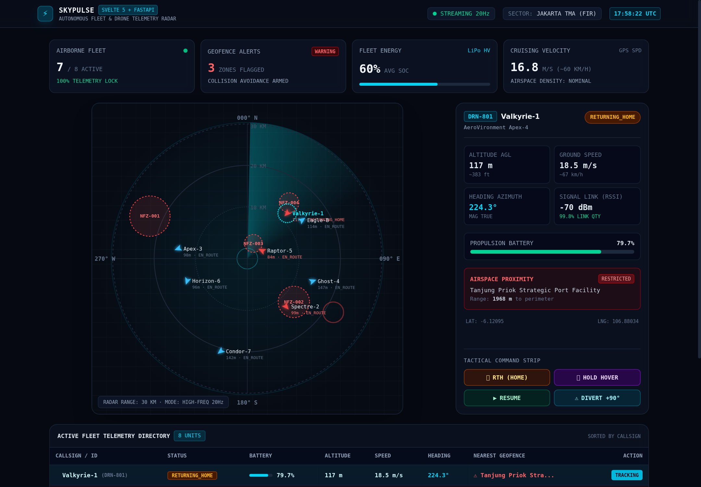

# SkyPulse — Autonomous Fleet & Drone Telemetry Radar



**SkyPulse** adalah sistem komando telemetri radar armada drone otonom berlatensi ultra-rendah (*ultra-low latency C2 Command & Control*), dibangun dengan **Svelte 5 (Runes `$state`, `$derived`, `$props`)** di sisi antarmuka dan **FastAPI (Python Asynchronous ASGI & WebSocket)** di sisi komputasi telemetri & geofencing.

---

## 1. Arsitektur Sistem

```
┌────────────────────────────────────────────────────────┐
│               Svelte 5 Tactical Cockpit               │
│  - Runes: $state, $derived, $props, $effect            │
│  - Tactical Polar Radar HUD (SVG + Scanline 20Hz)      │
│  - Drone Detail Telemetry & Artificial Horizon         │
│  - Fleet Directory & Mission Command Strip             │
└──────────────────────────▲─────────────────────────────┘
                           │  WebSocket Stream (20Hz)
                           │  REST API (Missions & Config)
┌──────────────────────────▼─────────────────────────────┐
│                 FastAPI Async Engine                   │
│  - Kinematic Motion & Battery Drain Simulator          │
│  - Spatial Geofencing (Haversine & Proximity Buffers)  │
│  - Autonomous Mission State Machine (RTH, HOLD, DIVERT)│
│  - OpenAPI Auto-Documentation (/docs)                  │
└────────────────────────────────────────────────────────┘
```

---

## 2. Fitur Utama

1. **High-Frequency Tactical Radar HUD (60 FPS / 20Hz Stream)**:
   - Tampilan Plan Position Indicator (PPI) dengan ring jarak 10 km, 20 km, dan 30 km serta azimuth derajat mata angin.
   - Efek sapuan radar dinamis (*sweeping beam*) dan visualisasi vektor orientasi heading drone.
   - Peta batas zona larangan terbang (*No-Fly Zones*) seperti bandara, pangkalan udara militer, dan instalasi strategis.

2. **Geofencing & Spatial Collision Engine**:
   - Algoritma perhitungan jarak Haversine bola bumi dengan zona penyangga peringatan (*warning buffer* 400m).
   - Deteksi otomatis pelanggaran batas wilayah udara dan penandaan status *WARNING* secara *real-time*.

3. **Autonomous Mission Command Strip**:
   - Pengiriman perintah kendali misi langsung ke armada:
     - 🏠 **RTH (Return To Home)**: Drone otomatis menghitung azimuth balik menuju pangkalan awal dan mendarat.
     - ⏸️ **HOLD**: Drone menghentikan laju horizontal dan beralih ke mode melayang (*hover*).
     - ▶️ **RESUME**: Melanjutkan penerbangan rute logistik pada kecepatan jelajah nominal.
     - ⚠️ **DIVERT**: Manuver penghindaran benturan (*collision avoidance*) dengan deviasi heading +90°.

4. **Svelte 5 Fine-Grained Reactivity**:
   - Menggunakan sintaks modern Svelte 5 Runes (`$state`, `$derived`) tanpa overhead Virtual DOM, menjaga render tetap mulus tanpa *dropped frames*.

---

## 3. Pratinjau Tampilan

### Cockpit Utama (Radar HUD, KPI Fleet, & Target Inspector)


### Eksekusi Perintah Misi (Return To Home / RTH)


---

## 4. Panduan Menjalankan Sistem

### A. Menjalankan Backend (FastAPI)

1. Masuk ke direktori backend dan aktifkan virtual environment:
   ```bash
   cd /root/skypulse/backend
   source venv/bin/activate
   ```
2. Jalankan server FastAPI:
   ```bash
   PYTHONPATH=. python app/main.py
   ```
3. Akses dokumentasi interaktif Swagger UI di:
   `http://localhost:8008/docs`

4. Menjalankan Automated Test Suite (Pytest):
   ```bash
   PYTHONPATH=. pytest tests -v
   ```

### B. Menjalankan Frontend (Svelte 5)

1. Masuk ke direktori frontend:
   ```bash
   cd /root/skypulse/frontend
   bun install
   ```
2. Build dan jalankan preview:
   ```bash
   bun run build
   bun run preview --host 0.0.0.0 --port 5173
   ```
3. Buka dashboard di browser pada:
   `http://localhost:5173`

---

## 5. Struktur Berkas Projek

```
/root/skypulse/
├── backend/
│   ├── app/
│   │   ├── main.py                    # Entrypoint FastAPI & Lifespan task runner
│   │   ├── models/schemas.py          # Pydantic v2 domain schemas
│   │   ├── services/
│   │   │   ├── geofence.py            # Haversine spatial & No-Fly Zone engine
│   │   │   └── telemetry_engine.py    # Autonomous fleet simulator & WebSocket hub
│   │   └── api/routes.py              # REST & WebSocket endpoints
│   ├── tests/test_telemetry.py        # Automated test suite (Pytest + AsyncClient)
│   └── requirements.txt
├── frontend/
│   ├── src/
│   │   ├── App.svelte                 # Root cockpit component (Svelte 5 Runes)
│   │   ├── main.ts                    # Mount entrypoint
│   │   ├── app.css                    # Tailwind CSS v4 & high-tech radar scanline
│   │   ├── types.ts                   # TypeScript interfaces
│   │   └── components/
│   │       ├── RadarDisplay.svelte    # Polar radar HUD & SVG vector plotter
│   │       ├── TelemetryCards.svelte  # Fleet aggregate KPI cards
│   │       ├── DroneDetailPanel.svelte# Selected drone cockpit & mission command strip
│   │       └── FleetListTable.svelte  # Live tabular fleet directory
│   ├── package.json
│   └── vite.config.ts
├── screenshots/
│   ├── skypulse_cockpit_live.png
│   └── skypulse_mission_rth.png
└── README.md
```
